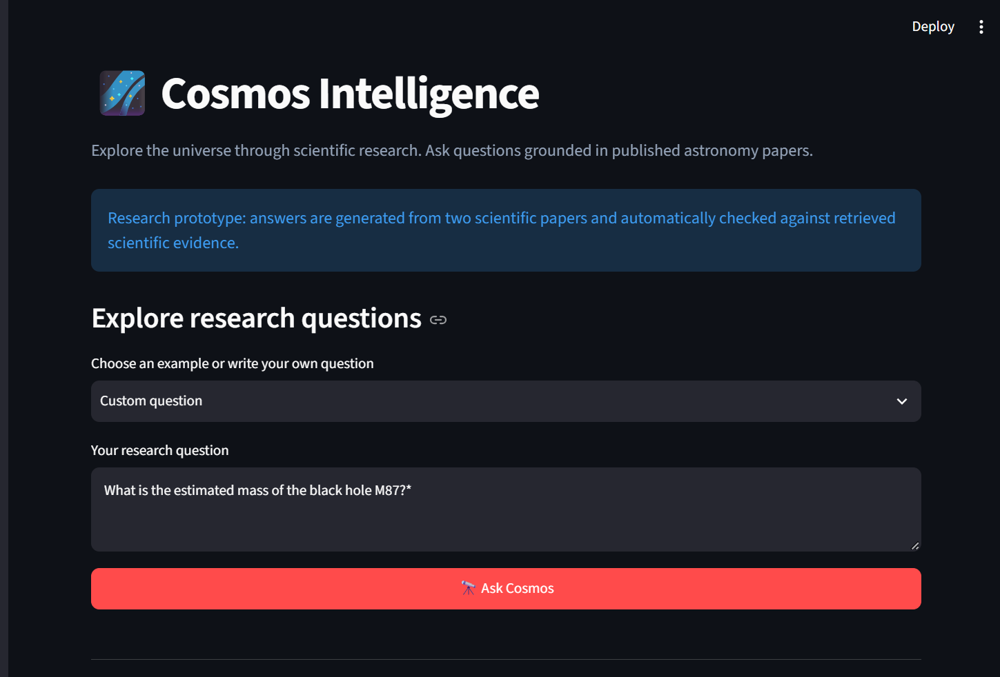
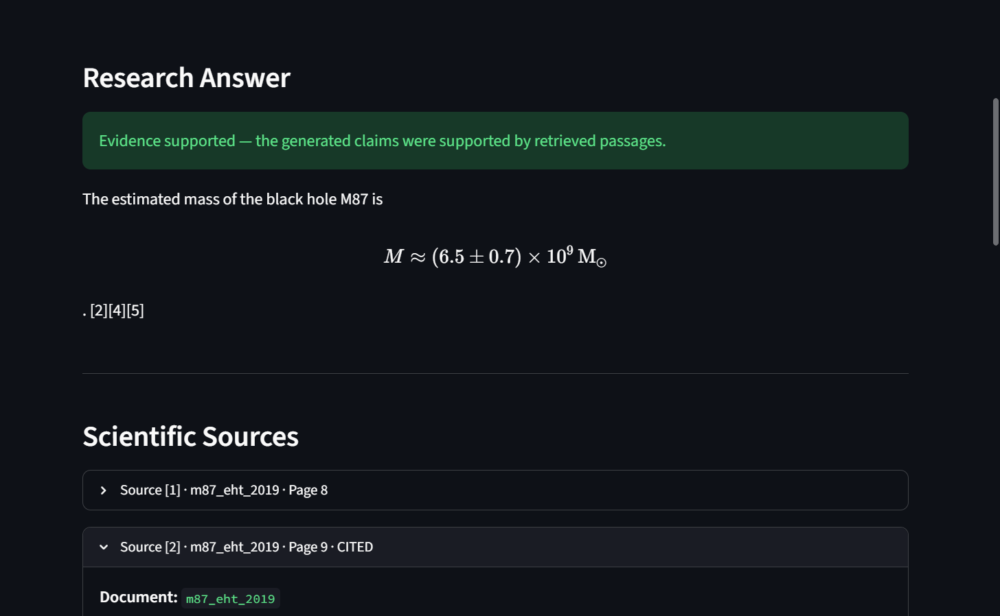
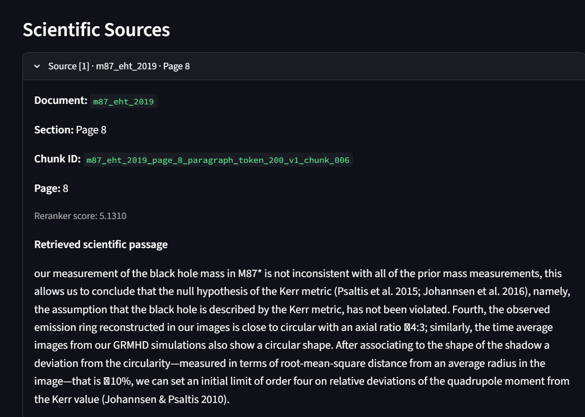
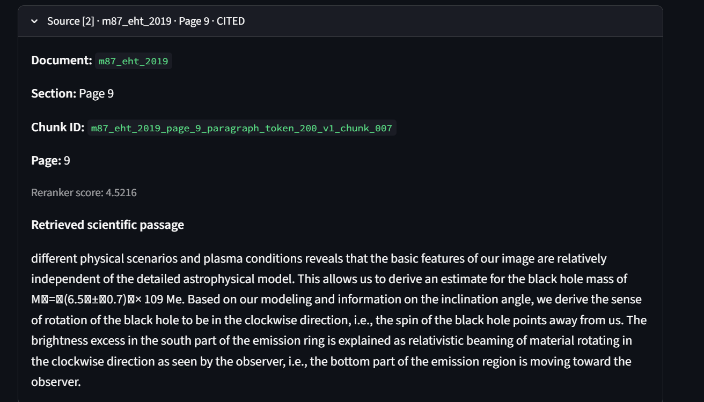
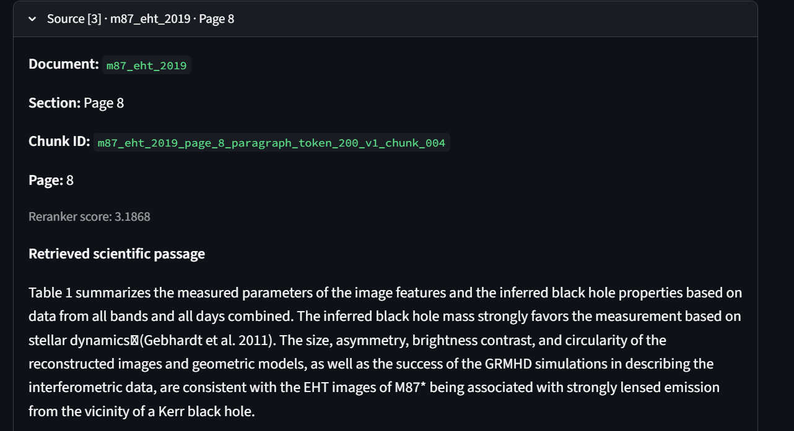
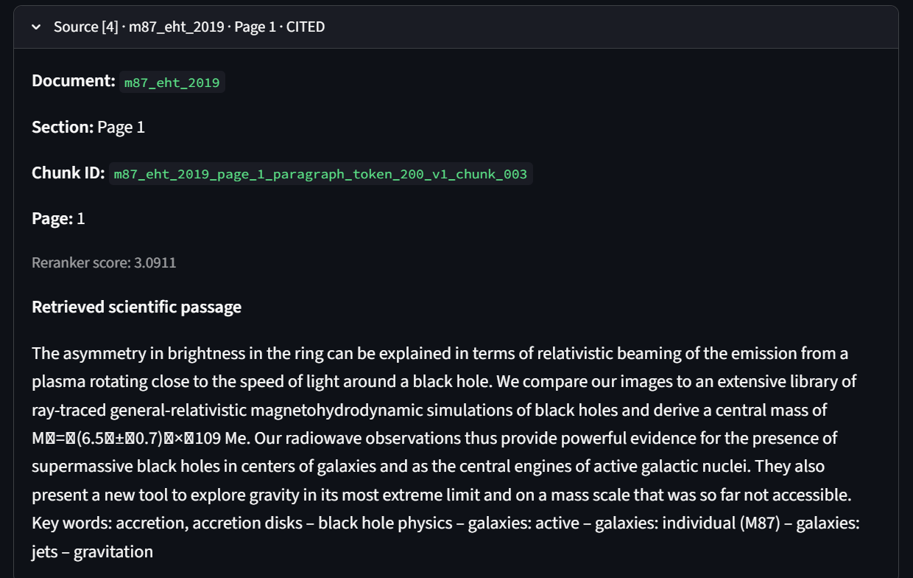
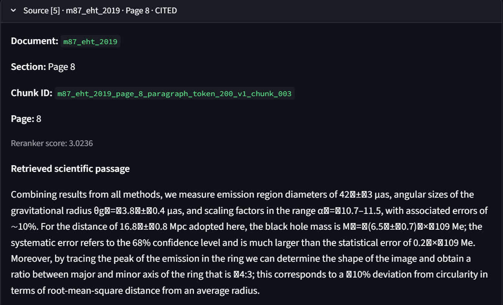

# 🌌 Cosmos Intelligence

### AI-Powered Astronomy & Space Research Copilot

Cosmos Intelligence is a locally running scientific research assistant built using **Retrieval-Augmented Generation (RAG)**. It retrieves evidence from published astronomy papers, generates research answers with a local large language model, checks claims against supporting passages, and displays source citations through an interactive Streamlit interface.

The project explores how hybrid information retrieval, cross-encoder reranking, and natural language inference can improve evidence-grounded scientific question answering.


## Application Demo

### 1. Ask a Scientific Question


### 2. AI-Generated Research Answer


### 3. Scientific Evidence and Citations

The application retrieves relevant passages from published astronomy papers and displays the supporting sources.








## Features

- **Multi-document research:** Search across JWST exoplanet research and Event Horizon Telescope black-hole observations.
- **Hybrid retrieval:** Combine BM25 keyword search with dense semantic embeddings using Reciprocal Rank Fusion.
- **Cross-encoder reranking:** Reorder retrieved passages based on question–passage relevance.
- **Local answer generation:** Generate answers using Qwen3-0.6B without requiring a paid LLM API.
- **Scientific claim verification:** Use natural language inference and evidence selection to evaluate support for generated claims.
- **Source citations:** Display document identifiers, source passages, and page references where available.
- **Interactive frontend:** Explore scientific questions through a Streamlit web application.
- **Retrieval evaluation:** Measure Hit@1, Hit@5, and Mean Reciprocal Rank.

## Research Corpus

The current version uses two scientific papers.

| Research topic | Paper | Year |
|---|---|---|
| Exoplanet atmospheres | JWST detection of carbon dioxide in WASP-39b | 2022 |
| Black-hole imaging | First M87 Event Horizon Telescope Results. I. The Shadow of the Supermassive Black Hole | 2019 |

The corpus contains **264 text chunks**: 52 from the WASP-39b paper and 212 from the M87 paper.

This is a deliberately small research prototype, not a comprehensive astronomy knowledge base.

## System Architecture

```text
Scientific Papers (JATS XML + PDF)
              |
              v
       Document Ingestion
              |
              v
    Paragraph-Aware Chunking
              |
              v
    MiniLM Dense Embeddings
              |
              v
     Scientific Chunk Index
              |
              v
         User Question
              |
              v
    BM25 + Dense Retrieval
              |
              v
     Reciprocal Rank Fusion
              |
              v
     Cross-Encoder Reranking
              |
              v
       Evidence Selection
              |
              v
      Qwen3-0.6B Generation
              |
              v
     NLI Claim Verification
              |
              v
 Verified Answer + Citations
              |
              v
       Streamlit Frontend
```

The application runs locally. Its language and embedding models are downloaded from Hugging Face when first needed.

## Technology Stack

| Component | Technology |
|---|---|
| Programming language | Python |
| Frontend | Streamlit |
| Local language model | Qwen/Qwen3-0.6B |
| Dense embeddings | sentence-transformers/all-MiniLM-L6-v2 |
| Keyword retrieval | BM25 |
| Rank fusion | Reciprocal Rank Fusion |
| Reranking | cross-encoder/ms-marco-MiniLM-L6-v2 |
| Claim verification | Natural Language Inference |
| PDF extraction | PyMuPDF |
| Numerical processing | NumPy |
| ML framework | PyTorch and Hugging Face Transformers |

## Evaluation

The project includes a retrieval evaluation workflow using manually prepared questions about the two research papers.

The observed reranked retrieval results on the curated evaluation set were:

| Metric | Result |
|---|---|
| Hit@1 | 100% |
| Hit@5 | 100% |
| MRR@5 | 1.0000 |

These results reflect a small, curated, two-document benchmark. They should not be interpreted as general-purpose retrieval accuracy or as proof that generated answers are always scientifically correct.

The project also includes experimental evidence-verification benchmarks and diagnostic scripts.

## Installation

### 1. Clone the repository

```bash
git clone https://github.com/YOUR_USERNAME/cosmos-intelligence.git
cd cosmos-intelligence
```

Replace `YOUR_USERNAME` with the actual GitHub username after publishing.

### 2. Create a Python environment

Python 3.13 was used during local development.

```bash
python -m venv .venv
```

On Windows PowerShell:

```powershell
.\.venv\Scripts\Activate.ps1
```

### 3. Install dependencies

```bash
python -m pip install -r requirements.txt
```

Model downloads require internet access on the first run. CPU execution is supported, although answer generation and verification can be slow.

## Preparing the Research Corpus

The repository excludes downloaded papers, processed JSON files, and generated embeddings to avoid committing large local artifacts.

You must prepare the source documents before running the application from a fresh clone.

### Expected input files

```text
data/
  raw/
    m87_eht_2019.pdf
    papers/
      wasp39b_co2_2022/
        article.xml
```

The M87 paper is available at:

https://arxiv.org/pdf/1906.11238

The WASP-39b source must be provided as the JATS XML article used by the ingestion pipeline. Its exact download URL should be documented before declaring the setup fully reproducible.

### Build the research index

After placing the source files in their expected locations, run these commands from the project root, in order:

```bash
python src/cosmos/ingest.py
python src/cosmos/chunking.py
python src/cosmos/embeddings.py

python src/cosmos/ingest_pdf.py
python src/cosmos/multi_paper_chunking.py
python src/cosmos/multi_paper_embeddings.py
```

These scripts create the processed chunks and combined embedding files used by the retrieval system.

The current index was built using 240-token chunks for WASP-39b and 200-token chunks for M87, with the `all-MiniLM-L6-v2` embedding model.

## Run the Application

Once the research index has been built:

```bash
python -m streamlit run app.py
```

Open the local URL shown in your terminal, usually:

http://localhost:8501

Example questions:

- What molecule did JWST detect in WASP-39b's atmosphere?
- At what wavelength was the carbon dioxide feature observed?
- What did the Event Horizon Telescope observe in M87?
- What is the estimated mass of the black hole M87*?
- Did JWST confirm intelligent life on WASP-39b?

The interface displays generated answers, evidence-verification status, and retrieved scientific passages.

## Run Retrieval Evaluation

```bash
python src/cosmos/evaluate_retrieval.py
```

The evaluation reports document-retrieval metrics for the configured test questions.

## Project Limitations

- **Small corpus:** The current version indexes only two astronomy papers.
- **PDF extraction quality:** Multi-column scientific PDFs, mathematical notation, and tables may introduce text-extraction errors.
- **Model limitations:** Qwen3-0.6B can generate incomplete or incorrect statements.
- **Verification limitations:** NLI-based evidence checking is an automated heuristic, not a guarantee of scientific truth.
- **Hardware performance:** Running the language model and verification models on CPU can introduce noticeable latency.
- **Local deployment:** The application is currently designed for local use rather than a hosted public service.
- **Reproducibility:** Fresh-clone setup depends on obtaining the original research documents and downloading model weights.

## Future Improvements

- Expand the astronomy research corpus.
- Add user-uploaded research-paper support.
- Improve scientific PDF layout and equation extraction.
- Introduce agentic research workflows and external scientific tools.
- Deploy the application to cloud infrastructure.
- Expand retrieval and answer-quality evaluation.

## Project Status

**Version:** 1.0 — Local research prototype

The core RAG pipeline, evidence-verification workflow, and Streamlit interface have been implemented and tested locally.

---

Built as a hands-on project in scientific information retrieval, natural language processing, and generative AI.